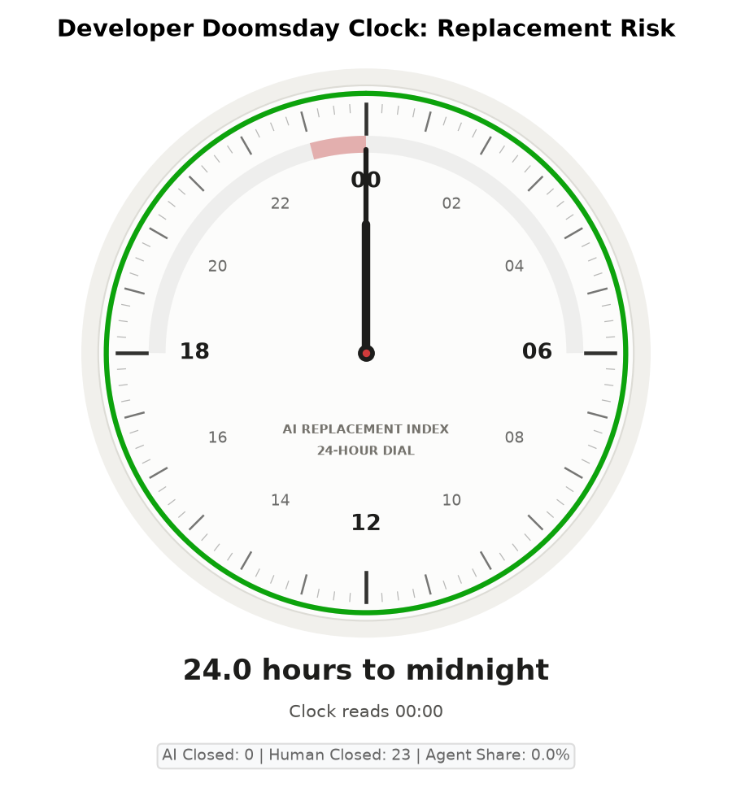

# AWS Emulator Agentic Workflow Issue Tracker

Automated daily tracking of open and closed issues in [`aws/aws-emulator`](https://github.com/aws/aws-emulator/issues) to measure issue resolution velocity from the AWS agentic workflow.

## Current Snapshot & Doomsday Clock

<!-- STATS_START -->
**Last Checked:** 2026-11-16 (UTC)  
- **Doomsday Clock Index:** 60.0 minutes to midnight  
- **Open Issues:** 444  
- **Closed by AI Agent:** 0  
- **Closed by Human:** 22  
- **Agent Resolution Share:** 0.0%
<!-- STATS_END -->

### The Developer Doomsday Clock

#### How is the Doomsday Clock Index Calculated?
The **Developer Doomsday Clock Index** measures how close your engineering repository is to total backlog chaos based on your open-to-closed issue ratio:
* **The Formula:** $\text{Minutes to Midnight} = \left(\frac{\text{Open Issues}}{\text{Total Issues}}\right) \times 60$
* **The Scale:** 
  * **60 Minutes to Midnight:** Complete backlog doom (0% of issues closed, maximum open pressure).
  * **0 Minutes to Midnight:** Total utopia (0 open issues remaining).
* **The Agent Factor:** We track whether issues are closed by human maintainers versus autonomous AI agents to see if the agentic workflow is actually turning back the clock or just watching time pass.

### Issue Resolution Trend

## Raw Data

Historical daily counts are stored in [`data.csv`](./data.csv).
