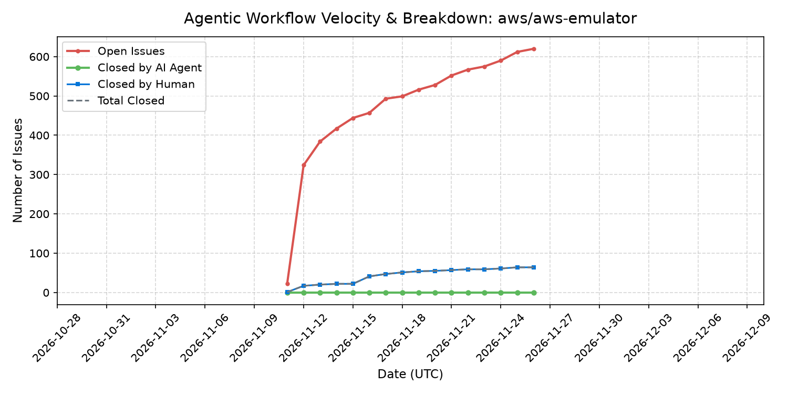

# AWS Emulator Agentic Workflow Issue Tracker

Automated daily tracking of open and closed issues in [`aws/aws-emulator`](https://github.com/aws/aws-emulator/issues) to measure issue resolution velocity from the AWS agentic workflow.

## Current Snapshot & Doomsday Clock

<!-- STATS_START -->
*Waiting for initial workflow run...*
<!-- STATS_END -->

### The Developer Doomsday Clock

### Issue Resolution Trend

## Raw Data

Historical daily counts are stored in [`data.csv`](./data.csv).
